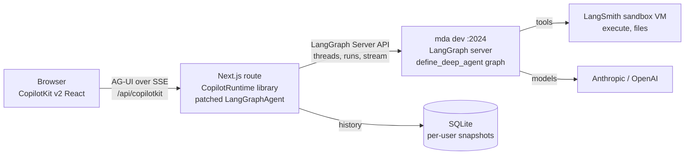

# Playbook: building on Managed Deep Agents + CopilotKit

A field guide for a coding agent starting a new app that puts a **Managed Deep Agents (MDA)**
agent behind a **CopilotKit v2** frontend. It holds what we learned while building the
Intelligence Workbench: what works, what the docs get wrong, and what breaks silently. You
should not have to rediscover any of it.

**Source repo:** <https://github.com/jzamalloa1/intelligence-workbench> (public). Paths below are
relative to its root. If you're working in a different repo, fetch the files from there. Every
pattern here has a working, commented implementation you can copy.

**Last verified:** 2026-10-17 against the versions in [§2](#2-versions-and-pinning-rules). The
whole stack is in public beta and ships weekly. Treat each claim as true on those versions, and
re-check it against the *installed package source* when versions move. The docs run ahead of
the code, and sometimes they're simply wrong.

---

## How to use this document

1. Read [§0 (the ten rules)](#0-the-ten-rules) and [§1 (architecture)](#1-architecture--what-runs-where) before writing any code.
2. Follow [§3 (bootstrap)](#3-bootstrap-from-zero-to-a-streamed-answer) in order. Each step ends with a check.
3. Before each feature, read its section in §4–§7. Most features have a trap that costs hours.
4. When something breaks, start at [§10 (symptom → cause)](#10-debugging-playbook-symptom--cause--fix).
5. Build every feature with a zero-cost check first ([§9](#9-testing-without-spending-money)). Then spend
   the smallest possible live model call to confirm it.

Sections:
[0 Rules](#0-the-ten-rules) ·
[1 Architecture](#1-architecture--what-runs-where) ·
[2 Versions](#2-versions-and-pinning-rules) ·
[3 Bootstrap](#3-bootstrap-from-zero-to-a-streamed-answer) ·
[4 Agent side (MDA)](#4-agent-side-mda--deepagents) ·
[5 Models](#5-models-claude-55-gpt-56-provider-agnostic) ·
[6 The bridge (AG-UI adapter)](#6-the-bridge-ag-ui-langgraph-adapter) ·
[7 Frontend (CopilotKit v2)](#7-frontend-copilotkit-v2) ·
[8 Security](#8-security-checklist) ·
[9 Testing](#9-testing-without-spending-money) ·
[10 Debugging](#10-debugging-playbook-symptom--cause--fix) ·
[11 Cost](#11-cost-control) ·
[12 Production](#12-toward-production) ·
[13 Upgrades](#13-upgrading-the-stack) ·
[14 File map](#14-reference-file-map)

---

## 0. The ten rules

Break any of these and you lose hours. Each one is explained further down.

1. **Talk to `mda dev` as a plain LangGraph server.** Use `LangGraphAgent` from
   `@ag-ui/langgraph`, with `graphId` set to `define_deep_agent(name=...)`. Do not add FastAPI or
   `add_langgraph_fastapi_endpoint`. MDA owns the server.
2. **Pin `@ag-ui/langgraph`, `@ag-ui/client` and `@ag-ui/core` to the exact versions
   `@copilotkit/runtime` depends on**, not npm latest. A caret range breaks every route.
3. **Every middleware implements both `wrap_*` and `awrap_*`** (or `before_*` and `abefore_*`). The
   server runs graphs async. A sync-only middleware passes its unit test and raises
   `NotImplementedError` on every real request.
4. **Subagent models get `disable_streaming=True`.** deepagents runs them inline. Their tokens
   surface at the run root, and parallel subagents splice into gibberish in the lead's message.
5. **Never set `backend`, `store`, `checkpointer`, `memory`, `skills` or `system_prompt` in
   `define_deep_agent`.** The runtime injects them. The system prompt is `instructions.md`.
6. **Never run plain `mda build .` while `mda dev` runs.** It empties `.mda/build/`, which is
   where the dev server keeps its threads. Use `mda build . --out <scratch>`.
7. **No CopilotKit frontend tools for the agent.** Make every UI action a *backend* tool that the
   browser renders and acts on. A frontend tool in a mixed turn triggers a follow-up run, which
   Claude 5.5 rejects with a prefill 400.
8. **Use `useInterrupt` for `interrupt_on` approvals, not `useHumanInTheLoop`.** Resume with
   exactly one decision per action request, in order.
9. **Add the patched `LangGraphAgent` subclass on day one.** It fills the null tool name on late
   starts, which AG-UI 1.0 makes fatal. Add the subagent tracker before you show subagent work.
10. **Close CopilotKit's `/threads…` REST endpoints on the local runner.** They have no user
    filter. Stamp the user server-side from a cookie, and never trust a client-sent identity.

---

## 1. Architecture — what runs where



- **Two processes locally.** `mda dev .` serves the agent on `:2024`. It compiles the project,
  then runs `uv run --with langgraph-cli[inmem] langgraph dev`, which is an ordinary LangGraph
  server with ~60 API paths. `npm run dev` runs Next.js on `:3000`, with the React UI and
  CopilotRuntime in the same process.
- **CopilotRuntime is an npm library in your API route**, not a service hosted by CopilotKit.
  Model keys live only in the agent process.
- **`mda dev` needs no beta access and no API key locally.** Only `mda deploy` is gated, on
  public-beta workspace access. `identity.py` gates deployed callers, not dev.
- **`CopilotKitMiddleware` (Python package `copilotkit`) composes into an MDA graph** through the
  author-settable `middleware=` field. Verified: its `before_agent` fires inside the MDA graph.
- **MDA's own docs say calling a deployed agent from your app "is not documented during beta".**
  That statement is about *deployed* agents. Local dev is a plain LangGraph server, and CopilotKit
  supports "self-hosted LangGraph servers" through `deploymentUrl` + `graphId`.
- **Why not FastAPI:** CopilotKit's Deep Agents quickstart uses
  `add_langgraph_fastapi_endpoint(LangGraphAGUIAgent(graph))`, which serves a graph *you*
  compiled. With MDA, the platform owns the server, so that path means not using MDA. Showcase
  tricks like `copilotkit_customize_config(emit_tool_calls=[...])` belong to that path. Under MDA,
  filter on the frontend instead.
- **CopilotKit Intelligence is optional.** It's a hosted persistence and observability layer
  (threads drawer, Inspector), reached from the runtime over a websocket. The agent never runs
  there. See [§7.9](#79-runners-local-vs-intelligence-and-history) for why Local should be the default.

---

## 2. Versions and pinning rules

Verified working together on 2026-10-17:

| Layer | Package | Version |
|---|---|---|
| Agent runtime | `managed-deepagents` (uv tool **and** project dep) | 0.9.0 |
| | `deepagents` | 0.7.23 |
| | `copilotkit` (Python) | 0.1.96 |
| | `langchain` / `langchain-core` / `langgraph` | 1.4.4 / 1.6.11 / 1.2.14 |
| | `langchain-anthropic` / `langchain-openai` | 1.7.6 / 1.7.0 |
| | Python / uv | 3.14 / ≥ 0.12 |
| Frontend | `@copilotkit/react-core`, `react-ui`, `runtime`, `a2ui-renderer` | 1.78.0 (exact) |
| | `@ag-ui/langgraph` | 0.0.44 (exact — what runtime 1.78.0 pins) |
| | `@ag-ui/client`, `@ag-ui/core` | 1.0.2 (exact) |
| | `next` / `react` / `typescript` | 16.3.6 / 19.3.0 / 5.9.3 |
| Models | Anthropic | `claude-opus-5-5` lead, `claude-sonnet-5-5` worker, `claude-haiku-5-5` cheap |
| | OpenAI | `gpt-5.6-terra` lead/worker, `gpt-5.6-luna` cheap |

**Pinning rules**

- **`@ag-ui/*`: match what `@copilotkit/runtime` depends on.** Read
  `node_modules/@copilotkit/runtime/package.json`. A newer `@ag-ui/langgraph` imports exports
  that an older `@ag-ui/core` lacks (`Export ... doesn't exist in target module`, every route
  500s). A mismatched `@ag-ui/client` duplicates `AbstractAgent`
  (`Types have separate declarations of a private property '_debug'`). After installing,
  `npm ls @ag-ui/client` must show a single copy. Add `@ag-ui/core` as a direct dependency if you
  import from it, rather than relying on hoisting.
- **`LangGraphAgent` comes from `@ag-ui/langgraph`.** `@copilotkit/runtime/langgraph` is the v1
  SDK, marked deprecated in its own types since 1.68.2.
- **Python: never `--prerelease allow`.** uv applies it globally, and it silently resolved
  langchain to an alpha and pydantic to a beta. Install the CLI with
  `uv tool install --python 3.14 managed-deepagents`.
- **`[tool.uv] prerelease = "disallow"` breaks `mda dev`.** The dev server's
  `uv run --with langgraph-cli[inmem]` needs `opentelemetry-semantic-conventions`, which only
  publishes `0.NNbN` versions. If a pre-release creeps in through a dependency, add
  `[tool.uv] constraint-dependencies = ["pkg<X.Y.0a0"]` for that one package, then lift it once a
  final release ships. Check with
  `grep -E '^version = "[0-9.]+(a|b|rc|\.dev)[0-9]+"' uv.lock`, which must print nothing.
- **MDA lives on two surfaces:** the `mda` CLI (a uv tool) and the project dependency. Upgrading
  one doesn't upgrade the other, and `uv tool install` never self-upgrades. Run `mda` directly
  (`mda dev .`), not through `uv run mda`.
- **`mda` needs Python ≥ 3.10.** On 3.9, uv resolves an ancient 0.4.0 that crashes on import.
  0.9 declares `>=3.11`.
- **Leave TypeScript at 5.9.x** until Next's build-time typecheck is verified on 7.x, the
  native-compiler major.

---

## 3. Bootstrap: from zero to a streamed answer

### 3.1 Repo hygiene first (the repo may be public)

Commit this `.gitignore` **before** any other file:

```gitignore
.env
.env.*
!.env.example
.mda/
*.sqlite
*.sqlite3
.venv/
node_modules/
.next/
```

Keep an `.env.example` with names only. Never echo a key value. Check presence with
`[ -n "$(printenv ANTHROPIC_API_KEY)" ] && echo SET || echo unset`.

### 3.2 Agent project (`agent/`)

```bash
uv tool install --python 3.14 managed-deepagents
mkdir agent && cd agent && mda init .     # then relax its exact pins (it pins ==, requires >=3.11)
uv add "managed-deepagents>=0.9.0" "copilotkit>=0.1.96" langchain-anthropic langchain-openai
```

A file's **location** decides its role in an MDA project:

| File | Role |
|---|---|
| `agent.py` | `agent = define_deep_agent(...)`. Keep it thin. |
| `instructions.md` | The lead's system prompt. MDA syncs it; you can't set `system_prompt`. |
| `sandbox/__init__.py` | `sandbox = define_sandbox(...)`. Without it, `execute` always fails. |
| `sandbox/setup.sh` | Baked into a sandbox snapshot when `mda dev` / `mda deploy` starts. |
| `memory.py` | `memory = define_memory(agent=MemoryLayer())`. Opt-in durable memory. |
| `identity.py` | `identity = define_identity(auth=auth.langsmith_api_key())`. Gates deployed callers. |
| `skills/<name>/SKILL.md` | Frontmatter `name` must equal the directory name. |
| `schedules/`, `channels/` | Static literals only. Schedules fire only when deployed. |

Minimal `agent.py`:

```python
from copilotkit import CopilotKitMiddleware
from langchain.agents.middleware import TodoListMiddleware
from managed_deepagents import define_deep_agent
from agent_core.models import build_model

agent = define_deep_agent(
    name="myagent",                      # == LangGraph assistant id == CopilotKit graphId; [A-Za-z][A-Za-z0-9_-]*
    model=build_model("lead"),           # an instance, not a string, so you can pass constructor args
    tools=[...],
    subagents=[...],                     # each with model=build_model("worker", stream=False)
    middleware=[CopilotKitMiddleware(), TodoListMiddleware(), ...],   # order is explicit
)
```

The only author-settable fields on a static definition are `name`, `model`, `tools`,
`middleware`, `subagents`, `permissions`, `interrupt_on`, `response_format`, `context_schema`,
`cache`, `debug`, `metadata` and `disable_memory`. 0.9 adds `instructions`, `mcp`, `sandbox`,
`skills` and `memory`, but **only for a factory entrypoint**, where `agent` is a function of the
runtime. Setting them on a static definition fails the build. Re-read
`inspect.signature(define_deep_agent)` after every bump.

**Check:** `mda dev . --no-browser`, then
`curl -s -X POST http://127.0.0.1:2024/assistants/search -H 'content-type: application/json' -d '{}'`
lists your graph id.

### 3.3 Web app (`web/`)

```bash
npx create-next-app@latest web --ts --tailwind --app
cd web
# Exact versions: read the runtime's own package.json for the @ag-ui pins.
npm i -E @copilotkit/react-core@1.78.0 @copilotkit/react-ui@1.78.0 @copilotkit/runtime@1.78.0 \
        @ag-ui/langgraph@0.0.44 @ag-ui/client@1.0.2 @ag-ui/core@1.0.2
npm i -D playwright-core          # zero-cost browser checks against your installed Chrome
```

Next 16 differs from what you were trained on. Read `node_modules/next/dist/docs/` before
writing route code.

`app/api/copilotkit/[[...slug]]/route.ts` (minimal; the hardening is in [§8](#8-security-checklist)):

```ts
import { CopilotRuntime, createCopilotRuntimeHandler, InMemoryAgentRunner } from "@copilotkit/runtime/v2";
import { MyLangGraphAgent } from "@/lib/my-agent";     // subclass of LangGraphAgent, see §6

const handler = createCopilotRuntimeHandler({
  runtime: new CopilotRuntime({
    agents: { myagent: new MyLangGraphAgent({ deploymentUrl: process.env.LANGGRAPH_URL ?? "http://127.0.0.1:2024", graphId: "myagent" }) },
    runner: new InMemoryAgentRunner(),
  }),
  basePath: "/api/copilotkit",
});
export const GET = handler;
export const POST = handler;
export const maxDuration = 300;   // runs stream for minutes
```

Provider and chat:

```tsx
import { CopilotKit, CopilotChat, useAgent, UseAgentUpdate } from "@copilotkit/react-core/v2";
import "@copilotkit/react-core/v2/styles.css";

<CopilotKit runtimeUrl="/api/copilotkit" agent="myagent" useSingleEndpoint={false} enableInspector={false}>
  <CopilotChat agentId="myagent" />
</CopilotKit>
```

**Check:** a one-line question ("reply OK") streams back. This costs one model call.

### 3.4 Day-one additions (do them before features)

1. The `LangGraphAgent` subclass ([§6.1](#61-the-subclass-you-need-from-day-one)).
2. `FriendlyErrorMiddleware` ([§4.8](#48-errors-make-failures-readable)). Without it, every provider failure looks the
   same in the UI: "An internal error occurred".
3. `ModelCallLimitMiddleware(run_limit=…)`. Since MDA 0.7.3 removed the platform recursion limit,
   this is the only ceiling on a run.
4. A wildcard tool renderer, `useRenderTool({ name: "*" })` ([§7.3](#73-rendering-tool-calls)).
5. Inspector off by default, behind `NEXT_PUBLIC_ENABLE_INSPECTOR`.
6. One `verify-*.mjs` script that stubs the run endpoint ([§9](#9-testing-without-spending-money)), copied for each feature.

---

## 4. Agent side (MDA + deepagents)

### 4.1 Middleware

- **Implement both hooks and share the logic.** Pattern:
  [agent/middleware/provider_prompt.py](../agent/middleware/provider_prompt.py) (`_merge` is used
  by both `wrap_model_call` and `awrap_model_call`). For blocking waits in an async hook, use
  `await asyncio.to_thread(...)`, never a blocking call on the event loop.
- **Order is explicit; write the reason next to each entry.** What we settled on, outermost
  first:

  | # | Middleware | Why there |
  |---|---|---|
  | 1 | `CopilotKitMiddleware()` | installs shared state and frontend tools before anything inspects the request |
  | 2 | `TodoListMiddleware()` | provides `write_todos` and `todos` state, which MDA and deepagents don't |
  | 3 | `AttachmentsMiddleware()` | `before_agent` rewrites attached files before the first model call |
  | 4 | `WriteBeforeExecuteMiddleware()` | tool-call hooks; an `execute` waits for its turn's writes |
  | 5 | `ProviderPromptMiddleware()` | appends provider steering to the system prompt |
  | 6 | `FriendlyErrorMiddleware()` | must sit *outside* the model call it protects |
  | 7 | `ModelCallLimitMiddleware` | run ceiling |
  | 8 | `ProviderSwitchMiddleware("lead")` | innermost of ours; swaps the model per call |

- **deepagents appends its own tail** after all author middleware, innermost: skills (since
  0.7.23), prompt caching, memory and approvals. You can't put yours after it.
- **Subagents don't inherit the lead's middleware.** List what each subagent needs in its spec.
- **MDA injects `runtime.backend` into author hooks**, the same way it does for tools. Use it to
  read and write sandbox files from middleware (`backend.aupload_files`, …).

### 4.2 `write_todos` / plan board

Neither MDA nor deepagents' default profile includes `TodoListMiddleware`. Without it, the tool
doesn't exist. Add it, and `todos` appears in state as `[{content, status}]` and streams in
`STATE_SNAPSHOT`.

### 4.3 Subagents

```python
{
  "name": "researcher",
  "description": "Researches one focused question … several can run in parallel.",  # the lead routes on this
  "system_prompt": RESEARCHER,          # not inherited
  "tools": [research, fetch_url],       # not inherited; this list only ADDS to the base stack
  "model": build_model("worker", stream=False),   # rule 4
  "middleware": [ProviderPromptMiddleware(), ProviderSwitchMiddleware("worker", stream=False),
                 HideToolsMiddleware({"execute"})],
}
```

- **Subagents run inline, through `subagent.invoke()` inside the lead's `task` tool**, not as a
  subgraph. That has three consequences:
  - their LLM token events surface at the run root, so set `disable_streaming=True`;
  - their messages never enter the lead's LangGraph thread (§6.3);
  - their tool calls show up one graph level deeper, in the path
    `tools:<id>|tools:<id>`, and that `|` is how you tell them apart.
- **Every subagent gets the filesystem tools**, plus **`execute` when a sandbox is attached**,
  whatever its `tools` says. deepagents' own tool exclusion is keyed to a harness profile chosen
  per *model*, so it can't target one subagent. To take a tool away, filter it out of every model
  request and refuse a forced call:
  [agent/middleware/tool_access.py](../agent/middleware/tool_access.py). Keep `interrupt_on`
  inherited so that removing the middleware by mistake fails closed.
- **Subagents inherit the lead's `interrupt_on`.** Parallel subagents can each pause, which leaves
  N pending interrupts on one thread (§6.5).
- **Fan-out multiplies cost.** N subagents × M searches × K results. Bound it in the prompts
  ("2–4 researchers, 2–3 searches each"), framed as a cost trade-off rather than a hard rule.
- **Soft instructions get skipped.** "Write notes as you go" produced zero files. "Write exactly
  one `/research/<topic>.md` with findings, numbers and sources" works.

### 4.4 Sandbox

```python
# sandbox/__init__.py
from managed_deepagents import define_sandbox
sandbox = define_sandbox(idle_ttl_seconds=600, default_timeout=600)
```

- **The sandbox is what makes `execute` real.** Without it, the `execute` tool is still listed,
  but `StateBackend` can't execute, so every call returns an error.
- **The feature is gated per organization.** Without it, every file operation raises
  `SandboxAuthenticationError: Sandbox feature is not enabled for this organization`, which the
  UI shows as a generic "An internal error occurred".
- **Files are not in agent state when a sandbox is attached.** The state snapshot holds only
  messages, todos and CopilotKit keys. Build any "workspace" view from streamed `write_file` /
  `edit_file` **tool calls**. `edit_file` carries a patch, so only `write_file` content can be
  shown in full.
- **Lifetime:** `idle_ttl_seconds` *stops* the sandbox; it doesn't delete it. The disk survives,
  and the sandbox restarts on the next command. Deletion comes `delete_after_stop_seconds` later,
  which the server set to 14 days. A follow-up hours later still finds its files.
- **Preinstall packages with `sandbox/setup.sh`.** The base image has Python but not pandas.
  Without setup, the agent spends several approved `pip install --break-system-packages`
  commands. `mda dev` bakes `setup.sh` into a snapshot at **startup**, so restart after changing
  it. Sandboxes that already exist keep the old snapshot.
  ```bash
  #!/usr/bin/env bash
  set -euo pipefail
  python3 -m pip install --quiet --break-system-packages pandas numpy openpyxl
  ```
- **Same-turn tool calls run concurrently.** A `write_file` followed by an `execute` in the same
  turn races, and fails with "No such file or directory". Fix it in code, not in the prompt: make
  `execute` wait for its turn's unanswered writes
  ([agent/middleware/ordering.py](../agent/middleware/ordering.py), with a 60 s cap).
- **Every `execute` is an approval** if you gate it, so tell the agent to "write one script and
  run it once."

### 4.5 Human-in-the-loop (`interrupt_on`)

```python
interrupt_on={"execute": InterruptOnConfig(allowed_decisions=["approve","edit","reject"],
                                           description=describe_execute)}   # callable → per-call plain-language text
```

- This raises a **LangGraph interrupt** through LangChain's `HumanInTheLoopMiddleware`. It is
  *not* a tool. The adapter forwards it as the custom event `on_interrupt`.
- The payload is `{action_requests, review_configs}`. The resume value is
  `{"decisions": [...]}`: **exactly one per action request, in order**, or LangGraph raises. Decision
  shapes: `{"type":"approve"}`, `{"type":"reject","message":"…"}`,
  `{"type":"edit","edited_action":{"name":"execute","args":{…}}}`.
- Gate only what's dangerous (`execute`). Gating something the agent calls constantly turns every
  run into a click-fest without adding safety.
- Frontend handling is in [§7.4](#74-approvals-useinterrupt), and multiple pending interrupts in [§6.5](#65-multiple-pending-interrupts).

### 4.6 Memory and identity

- `memory.py`: on 0.8+ use `define_memory(agent=MemoryLayer())`. The 0.8 CLI rejects
  `scope="agent"` at build time, even though the Python function still accepts it.
- **Agent memory is shared across the whole deployment.** `/memories/agent/AGENTS.md` is loaded
  into every run for every caller, so whatever one caller gets saved is read by everyone after.
  Treat it as untrusted input. Never store personal data or credentials there, and never let
  memory grant authority.
- A per-user layer (`user=MemoryLayer(allow=...)`) exists, but it only mounts for *trusted
  identities*: a verified Studio user or a managed Slack DM. A browser reaching the agent through
  CopilotKit is neither. 0.9 adds a trusted-backend identity path. We haven't verified it.
- Restart `mda dev` after adding `memory.py`, `identity.py`, `skills/`, `schedules/`,
  `channels/` or `sandbox/setup.sh`. These are discovered at compile time.

### 4.7 Configuration and environment

- **The project `.env` overrides exported shell variables.** `LLM_PROVIDER=openai mda dev .` does
  nothing. Edit `.env` and restart.
- **Per-run settings travel as request headers.** CopilotKit forwards `x-` headers into each run's
  `configurable.copilotkit_forwarded_headers`, and deepagents passes the parent's configurable to
  subagents, so one header reaches every call. Read it with `langgraph.config.get_config()` inside
  the graph ([agent/agent_core/models.py](../agent/agent_core/models.py) `run_provider()`). We
  didn't need a `context_schema`.
- A conda env may set `VIRTUAL_ENV`. uv's warning that it "does not match the project
  environment" is harmless.

### 4.8 Errors: make failures readable

- Catch provider errors at the model-call boundary and return an `AIMessage` that explains the
  failure (bad key, no credits, rate limit), so the run completes with the cause in the
  transcript. Catch `langchain_core.exceptions.ModelAPIError` **and** each SDK's `APIError`. An
  error inside an accepted stream, like OpenAI's "no credits remaining", is the SDK's own class.
- **A hand-built `AIMessage` must carry `response_metadata={"stop_reason": "end_turn"}`.** The
  adapter opens a text message for it and closes it only on a stop or finish reason. Without one,
  the run ends with AG-UI `INCOMPLETE_STREAM` ("Cannot send 'RUN_FINISHED' while text messages are
  still active").
- Also treat **HTTP 200 with `stop_reason: "refusal"`** (Claude 5.5 safety decline) as a case to
  explain, and drop any partial tool calls.
- Implementation: [agent/middleware/errors.py](../agent/middleware/errors.py).

### 4.9 Context growth and summarization

- deepagents' `SummarizationMiddleware` triggers at **85% of `model.profile["max_input_tokens"]`**.
  For 1M-window models, that's ~850K, so in practice it never fires while every call re-sends the
  whole history.
- Fix: declare a smaller window on each model you build. For example,
  `profile["max_input_tokens"] = min(window, 200_000)` moves the trigger to ~170K. Apply it to
  every tier and provider, including models swapped in at run time
  ([models.py `_budgeted`](../agent/agent_core/models.py)). Mirror the number in the UI's context
  meter.
- Prompt caching has a 5-minute TTL, so a follow-up hours later re-caches the full history at
  write price.
- The summarizer counts tokens with `count_tokens_approximately`: images cost a flat 85, and any
  other block costs `len(repr(block))`. A base64 PDF left in state reads as ~330K tokens and
  compacts the conversation on its first call. Never leave file bytes in state (§4.10).

### 4.10 File attachments (end to end)

- **CopilotChat 1.78:** `attachments={{ enabled, accept, maxSize, onUpload, onUploadFailed }}`.
  It sends AG-UI content parts (`image` / `document` with base64 `data`) after the text. It has
  **no error UI of its own**, so show `onUploadFailed` yourself. `maxSize` is checked *before*
  `onUpload`, so allow large photos that `onUpload` will downscale.
- **`@ag-ui/langgraph` 0.0.44:** an image becomes an `image_url` data-URL block, with the filename
  in `additional_kwargs["ag-ui"].attachments` keyed by block index. A document becomes
  `{type:"file", source_type:"base64", mime_type, metadata.filename}`.
- **langchain-anthropic** sends base64 files as `document` blocks. **Anthropic accepts base64
  documents only as PDF**, so a CSV gets a 400.
- **Pattern that works:** a `before_agent` middleware saves each file into the sandbox
  (`/workspace/attachments/<name>`, MDA's own Slack convention) and replaces each non-image block
  with a plain-text note (inline text up to ~12K chars, a preview beyond that, pypdf text for
  PDFs). It must be idempotent. Keep images as images.
  [agent/middleware/attachments.py](../agent/middleware/attachments.py), with the UI side in
  [web/src/lib/attachments.ts](../web/src/lib/attachments.ts) (note parser → file chips).
- Cap non-image files at ~5 MB. Before the rewrite, the base64 rides in the run request, and AG-UI
  caps each SSE frame at 10 MB, with base64 adding a third.

---

## 5. Models (Claude 5.5, GPT-5.6, provider-agnostic)

- **One module owns every model ID** and hands out *roles* (`lead` / `worker` / `cheap`). Tiering
  by role is the biggest cost lever. Build **instances**, not `"provider:model"` strings, because
  you need constructor arguments. Pattern:
  [agent/agent_core/models.py](../agent/agent_core/models.py).
- **Claude 5.5 specifics** (see Anthropic's migration guide):
  - **Thinking is always on and adaptive; effort is the only dial,** and its default differs per
    model (Opus 5.5 `medium`, Sonnet 5.5 `high`). Set it explicitly. `budget_tokens` is a 400.
  - **Thinking is billed but hidden by default** (`display: "omitted"`). Set
    `thinking={"type":"adaptive","display":"summarized"}` on the streaming lead to show reasoning
    at no extra cost. Don't set it on hidden, non-streaming subagents.
  - **Thinking blocks are bound to their exact prefix.** If the system prompt, tools or an earlier
    message changed, replaying a block is a 400. Summarization and the memory and skills
    middleware all rewrite the prefix. Send
    `thinking.block_binding = {"prefix_mismatch_behavior": "drop_block"}` with the beta
    `thinking-binding-controls-2026-08-01` on every tier.
  - **No assistant prefill.** A conversation ending on an assistant message is a 400. It's rejected
    before billing, which makes it a free reproduction.
  - **A forced `tool_choice` is a 400** on Opus and Sonnet 5.5.
  - **Leave server-side `fallbacks` off** for now. A mid-stream fallback adds a content block that
    langchain-anthropic doesn't handle.
- **OpenAI:** use the Responses API (`use_responses_api=True`, `reasoning={"effort":…}`, plus
  `"summary":"auto"` for visible reasoning). GPT-5.6 effort accepts
  `none|low|medium|high|xhigh|max`; it's a pass-through string even though langchain's docstring
  lists four values.
- **Provider per conversation:** a header sets it, a middleware swaps the model per call, and it
  strips Anthropic cache marks when switching away. **Keep a conversation on its first provider,
  enforced server-side,** because thinking blocks from one provider are unreadable to the other.
  [agent/middleware/provider_switch.py](../agent/middleware/provider_switch.py).
- **Prompts stay lean.** Both vendors' 2026 guidance: over-specification costs quality. Anthropic:
  markdown, XML only for real nesting, never ask for chain-of-thought in prose. OpenAI: numbered
  lists and headers; XML underperforms on GPT-5.x. Keep a shared core prompt plus a thin
  per-provider delta appended by middleware.
- **Prices** live in one file with the date and source checked. Re-fetch the pricing pages rather
  than trusting memory. Match the longest model ID first, or `claude-opus-5-5` gets priced as
  `claude-opus-5`.

---

## 6. The bridge (`@ag-ui/langgraph` adapter)

The adapter translates LangGraph stream events into AG-UI events. Most surprises live here.
Override it in one subclass:
[web/src/lib/workbench-agent.ts](../web/src/lib/workbench-agent.ts).

### 6.1 The subclass you need from day one

```ts
export class MyLangGraphAgent extends LangGraphAgent {
  override handleSingleEvent(event: any): void {
    if (event && !Array.isArray(event) && event.event === "on_tool_end") nameAnonymousToolMessages(event);
    super.handleSingleEvent(event);
  }
}
function nameAnonymousToolMessages(event: any) {
  const output = event.data?.output;
  if (typeof event.name !== "string" || !output || typeof output !== "object") return;
  for (const m of output.tool_call_id ? [output] : (output.update?.messages ?? []))
    if (m?.type === "tool" || m?.tool_call_id) m.name ??= event.name;
}
```

**Why:** when a tool call's streamed start never arrived (for example, non-streamed calls), the
adapter emits a late `TOOL_CALL_START` from `on_tool_end`, naming it from the ToolMessage. Tools
that return a `Command` (`write_todos`, `task`) build that ToolMessage **without a name**, so
`toolCallName: null` goes out. AG-UI 1.0's strict checking makes a malformed required field
fatal. The UI freezes at the plan step while the agent keeps working in the background.

Fixed upstream in 0.0.44, so no longer patched: a tool call directly after text in the same
response used to be dropped.

**On every `@ag-ui/langgraph` bump**, run a replay script that feeds synthetic events through the
stock adapter and yours, and reports which patches are still needed:
[web/scripts/verify-adapter.ts](../web/scripts/verify-adapter.ts).

### 6.2 Stream facts

- Default stream modes are `["events","values","updates","messages-tuple"]`. `events`
  (`on_chat_model_stream`) is the primary source. Removing it silences the UI.
- **Don't set `emitRawEvents: false`.** RAW events carry the original LangGraph events, and you
  need them for usage and subagent tracking.
- `MESSAGES_SNAPSHOT` is sent on every lead↔subagent switch and at the end of the run. The client
  **keeps only messages whose ids appear in the snapshot**.
- `STATE_SNAPSHOT` **replaces** client state. Anything you add to state must go into every
  snapshot.
- **The adapter's final snapshot omits reasoning messages.** Re-insert them if you show reasoning
  cards.
- AG-UI 1.0 details:
  - a tool message's `content` can be a content-part array, so flatten it;
  - `THINKING_*` events are gone, replaced by `REASONING_*`;
  - there's a `cancelled` run outcome, which you should show as "Stopped";
  - unknown fields are stripped with a warning;
  - each SSE frame is capped at 10 MB.
- Volume: one long run relayed ~53 MB, mostly ~40 KB full snapshots × hundreds. The browser
  copes, but trim if long runs feel sluggish.

### 6.3 Subagent work vanishes unless you keep it

Subagents' messages never enter the lead's thread, so the next `MESSAGES_SNAPSHOT` deletes their
tool calls from the client. They're never saved to history either. Fix:
[web/src/lib/subagent-tracker.ts](../web/src/lib/subagent-tracker.ts).

- **Outbound:** recognize subagent calls by graph path depth (the `|`). Tag them with AG-UI's
  `subagentRunId`, set to the first path segment, which is one id per `task` call. Re-insert them
  into every `MESSAGES_SNAPSHOT` after the lead message holding the `task` call, with the ids the
  client already has. Seed the tracker with the run's input messages so earlier turns survive.
- **Inbound (critical):** the adapter's `langGraphDefaultMergeState` sends every client message
  the thread doesn't hold as **new input**. The re-inserted subagent messages would be written
  into the lead's thread, between a `tool_use` and its result. Strip them, and their tool results,
  from each run's input.
- This must live in the agent subclass, not the runner. The in-memory runner records events
  before a runner subclass sees them, so a reconnect would replay unfixed snapshots.

### 6.4 Usage and cost numbers

- `RUN_FINISHED.usage` is built from streamed chunks only, so it misses non-streaming subagents.
  It reported 54K input tokens where the calls' own reports summed to 1.28M.
- Read each call's `on_chat_model_end` RAW event instead: model, depth (lead or subagent), input,
  output and cache tokens. Two quirks:
  - `input_tokens` already **includes** cache reads and writes;
  - the streaming lead reports cache writes as `cache_creation`, while non-streaming subagents
    report them as `ephemeral_5m_input_tokens` with `cache_creation: 0`.
- Carry the per-call list in state: a STATE_DELTA after each call, added to every snapshot, and
  stripped from the run input before the adapter sends it to the graph. Apply prices in the
  browser, so a price change needs no re-run.
  [web/src/lib/usage-tracker.ts](../web/src/lib/usage-tracker.ts).

### 6.5 Multiple pending interrupts

Parallel subagents can each hit `interrupt_on`, and three layers assume a single interrupt:

- `useInterrupt`'s legacy path keeps only the last event;
- CopilotKit resumes with a bare `forwardedProps.command.resume`;
- LangGraph then raises "When there are multiple pending interrupts, you must specify the
  interrupt id".

The adapter's native multi-resume wraps answers in `__agui_resume_map__`, which only the Python
AG-UI server unwraps. MDA's plain LangGraph server doesn't.

Fix:

- Set `emitInterruptOutcome: true` on the agent, so `RUN_FINISHED` carries every open interrupt
  with its id.
- Override `buildCommandResumeFromAgui` to return `{interrupt_id: decision}`.
- In `prepareStream`, read the thread's pending interrupts and address a bare resume to the one
  the card showed.

[web/src/lib/interrupt-resume.ts](../web/src/lib/interrupt-resume.ts).

### 6.6 Regenerate / edit

The adapter can fork a thread from the checkpoint before a message (`prepareRegenerateStream`), but
it only triggers on its own when the browser sends a message the thread doesn't hold. Pass an
explicit marker in `forwardedProps`, call `prepareRegenerateStream` yourself, and **strip the
marker** first, because the adapter spreads `forwardedProps` into the LangGraph run request. The
call fails ("Message not found") after the agent server lost the thread, for example after a
rebuild. Say so in the UI.

---

## 7. Frontend (CopilotKit v2)

Import everything from `@copilotkit/react-core/v2` (`CopilotKit`, `CopilotChat`, `useAgent`,
`useRenderTool`, `useInterrupt`, `useConfigureSuggestions`, `OpenGenerativeUIActivityRenderer`, …)
and the runtime from `@copilotkit/runtime/v2`.

### 7.1 Reading agent state

```ts
const { agent } = useAgent({ agentId: "myagent",
  updates: [UseAgentUpdate.OnMessagesChanged, UseAgentUpdate.OnStateChanged, UseAgentUpdate.OnRunStatusChanged] });
```

Without `updates`, the hook doesn't subscribe and nothing re-renders. Derive panels as **pure
functions** over `agent.messages` and `agent.state` (plan from `state.todos`, files and activity
from tool calls). There's no event bookkeeping to get wrong.

### 7.2 The chat

- `messageView={{ transformMessages, groupMessages }}` lets you hide rows (for example,
  subagent tool calls) and group a delegation burst into one expandable block. Keep the object
  and its functions **stable**, because CopilotChat memoizes on them.
- `onRegenerate` / `onEditMessage`: `onEditMessage` gets the message *as displayed* (after your
  transforms). Look up the raw one in `agent.messages`.
- Suggestions: `useConfigureSuggestions({ suggestions, available })`, where `available` is `"before-first-message"`, `"after-first-message"`, `"always"` or `"disabled"` (we use it for follow-up chips). Starter
  cards send on click, so test scripts must stub the run endpoint.
- **Theme through your tokens.** Map CopilotKit's shadcn-style variables (`--background`,
  `--foreground`, …) to yours under `html:root [data-copilotkit]`, a selector that beats its
  `.dark [data-copilotkit]`. Keep a `.dark` class on `<html>` for its `dark:` utilities.
- The `flushSync` console errors during runs come from inside `@copilotkit/react-core`. They're
  dev noise, and harmless.

### 7.3 Rendering tool calls

- `useRenderTool({ name: "*", render })` replaces the built-in wildcard row (which says nothing)
  with a card showing the tool, its target and an expandable result.
- Named renderers take `parameters: z.object(...)` with **every field optional/nullish**, because
  they render during streaming with partial args. `status` is `inProgress` → `executing` →
  `complete`, and `result` may be a JSON string.
- **Rich UI should be a tool call.** Tool calls are in `MESSAGES_SNAPSHOT`, so they survive
  reopening a conversation. Activity messages aren't (§7.6).

### 7.4 Approvals: `useInterrupt`

```tsx
useInterrupt({
  enabled: (event) => parseHITLRequest(event?.value) !== null,   // only payloads you recognise
  render: ({ event, interrupts, resolve }) => /* card(s) */,
});
```

- `useHumanInTheLoop` is the wrong hook here: it registers a frontend *tool* answered by a human.
  `interrupt_on` emits the `on_interrupt` custom event, and `INTERRUPT_EVENT_NAME` is literally
  `"on_interrupt"`.
- On the legacy path, the standard `interrupt` prop is null. Read `event.value`, which arrives
  **JSON-stringified**, so parse it defensively. On the standard path (`emitInterruptOutcome:
  true`), `interrupts[]` carries each with its `id`, so call `resolve({decisions}, id)`.
- Hold one decision per action request and resolve only when all are made.
- Pattern: [web/src/components/ApprovalCard.tsx](../web/src/components/ApprovalCard.tsx),
  `useApprovals` in [web/src/app/page.tsx](../web/src/app/page.tsx).

### 7.5 UI actions by the agent: backend tools, not frontend tools

A CopilotKit frontend tool (`useFrontendTool`) called in the same turn as backend tools goes
wrong in three steps:

- the backend half runs, and the agent continues without the frontend tool's result;
- the browser executes the frontend tool *after the run ends* and appends its result after the
  final answer;
- the browser starts a follow-up run whose conversation ends on an assistant message, and
  Claude 5.5 rejects it with a prefill 400.

**Instead:** define a backend tool that returns at once ("Shown to the user: …"), and have its
renderer perform the UI action. Act once per `toolCallId`, and only when the call was seen
streaming or a run is active, so replayed history doesn't re-trigger it.
[agent/tools/ui.py](../agent/tools/ui.py) + `useFocusPanel` in
[web/src/app/page.tsx](../web/src/app/page.tsx).

### 7.6 Generative UI: charts, A2UI dashboards, agent-written widgets

**Charts:** let the agent send **structured data as tool arguments** (`render_chart(type, series,
…)`), not an image file. The browser draws them (Recharts), they're interactive, they survive
reopening, and the agent can reference them by id.
[agent/tools/charts.py](../agent/tools/charts.py).

**A2UI dashboards.** CopilotKit's built-in A2UI paths don't fit:

- `CopilotRuntime({ a2ui })` paints from an `a2ui-surface` *activity message*. Activity messages
  aren't in `MESSAGES_SNAPSHOT`, so the dashboards vanish on reopen.
- `generate_a2ui` is a LangChain-JS tool that makes its own model call from the web server.

What works:

- Write a backend tool whose **arguments are the A2UI v0.9 component list**, and validate them
  server-side: ids, types, props, child refs, cycles, depth and size.
- The browser converts the call into
  `[{version:"v0.9", createSurface:{surfaceId, catalogId}}, {version:"v0.9", updateComponents:{surfaceId, components}}]`
  and feeds `processMessages` inside `A2UIProvider` (`@copilotkit/a2ui-renderer`), with a catalog
  built by `createCatalog`.
- Use one provider per view. A full-screen copy needs its own surface id.
- Keep the Python catalog and the TS catalog listing the same components and props.
- **zod trap:** the renderer uses zod 3.25, and your app may use zod 4 (`zod/v3`). Letting `tsc`
  infer `createCatalog` generics across both makes `tsc --noEmit` hang for minutes. Type renderers
  with plain prop types, and pass the catalog through `unknown`.

Files: [agent/tools/dashboard.py](../agent/tools/dashboard.py),
[web/src/components/dashboard/](../web/src/components/dashboard/).

**Open Generative UI (agent-written HTML widgets).** As with A2UI, the built-in path uses activity
messages. Render `OpenGenerativeUIActivityRenderer` yourself, with
`content={ html:[doc], htmlComplete:true, cssComplete:true }` built from a backend tool's `html`
argument. The widget is model-written code, so keep **three walls**:

1. websandbox's iframe is `sandbox="allow-scripts"` only, which gives it an opaque origin. **Never
   add `allow-same-origin`.**
2. **The iframe does not stop network requests; a CSP does.** Wrap the widget as
   `<!DOCTYPE html><html><head><meta http-equiv="Content-Security-Policy" content="default-src 'none'; script-src 'unsafe-inline'; style-src 'unsafe-inline'; img-src data: blob:; font-src data:; form-action 'none'; base-uri 'none'">…</head><body>{model html}</body></html>`.
   Put the model's document *inside your body*, so nothing it writes is parsed before your policy.
   websandbox injects its bootstrap at the first literal `<head>`, which is yours. It runs code as
   inline scripts (no `eval`), so `'unsafe-inline'` is enough.
3. **No CSP blocks self-navigation.** Close the widget when its frame fires a second `load`. The
   request has already left by then, but the page stops.

Register no `useSandboxFunctions` host functions unless you've thought about what a hostile page
could call. File: [web/src/components/WidgetCard.tsx](../web/src/components/WidgetCard.tsx). Test it
with [web/scripts/verify-widget.mjs](../web/scripts/verify-widget.mjs), which attacks with
`fetch`, a beacon, a remote image and a CDN script, and includes a control that proves the
capture works.

**Placement:** chat cards get cramped. Add a full-screen view (a second, fresh render) rather than
moving generative UI into a side panel.

### 7.7 Provider-level `<CopilotKit>` facts

- `ProxiedCopilotRuntimeAgent` negotiates transport **once per instance**, with `GET …/info`, and
  caches whether Intelligence is available. Changing `headers` later doesn't renegotiate. **To
  switch runners, remount**: `key={mode}` on `<CopilotKit>`. Without the remount, the client keeps
  its websocket protocol against an SSE endpoint, which fails with "Unexpected token 'd', "data:
  {"ty"... is not valid JSON".
- `headers` can be a function, evaluated per request. That's how per-conversation settings
  (`x-llm-provider`, `x-runner`) reach the route.
- `enableInspector` defaults **on** in development. It mounts a floating launcher and a "View in
  Inspector" button on every assistant message. Default it off, behind an env var.
- `onError` is the only place a runner connection drop becomes visible. Surface it as a banner.

### 7.8 The route

- `CopilotRuntime`'s options are a **union**. The Intelligence variant requires `identifyUser`
  (or `channels`), and leaving it out is a type error.
- In Intelligence mode, a run returns a `joinToken` plus a `wss://` topic instead of streaming
  over HTTP. A curl check looks empty even on success, so check the agent log for
  `Background run succeeded` instead.
- Set `maxDuration` high. Runs last minutes.

### 7.9 Runners: Local vs Intelligence, and history

- Exported runners: `InMemoryAgentRunner` and `IntelligenceAgentRunner`. `SqliteAgentRunner` is
  **not** in `@copilotkit/runtime`. It ships separately as `@copilotkit/sqlite-runner`, and it has
  no per-user ownership.
- **Make Local the default.** Intelligence's hosted realtime gateway gives up reconnecting after
  **60 s** (`reconnectGiveUpMs`, not configurable through any public option). Long runs and
  human-paced approvals hit that ceiling: the agent *finishes* (`run_exec_ms=356661` in the log),
  and the browser throws the result away.
- **Durable local history means your own store.** `InMemoryAgentRunner` forgets everything on
  restart, and `mda dev`'s thread persistence is wiped by every compile (rule 6). Subclass the
  runner:
  - on `run`, register the thread under the user, then save the run's **last
    `MESSAGES_SNAPSHOT` and `STATE_SNAPSHOT` as the browser received them**, since those include
    the re-inserted subagent work;
  - on `connect`, use the in-memory replay, then the agent server's thread, then the stored
    snapshot.

  Saving must never fail a run.
  [web/src/lib/server/history-runner.ts](../web/src/lib/server/history-runner.ts).
- A deployed MDA agent has durable threads. The wipe-on-compile problem is local only.

---

## 8. Security checklist

- [ ] **Identity is server-side.** Read the user from an httpOnly cookie in the route. Overwrite
      any client-sent user header before forwarding (`headers.delete(USER_HEADER);
      headers.set(USER_HEADER, user.id)`). Never read the user from a body or a client header.
- [ ] **Ownership checked on every agent call.** Match `/agent/:id/(run|connect|stop)`, extract
      the thread id from the body (or the path for `stop`), and return **404** for someone else's
      thread, the same as for one that doesn't exist.
- [ ] **CopilotKit's `/api/copilotkit/threads…` endpoints are closed on the local runner.** They
      list, read and *clear* every in-process conversation, with no user filter. Return 404. Keep
      them only on Intelligence, which scopes by `identifyUser`. History goes through your own
      owner-checked `/api/threads`.
- [ ] **Stamp the owner on agent-side threads** (`createThread` metadata `user_id`), so traces and
      `/threads/search` show it.
- [ ] **No shell for agents that read untrusted content.** Researchers reading the web get
      `fetch_url`, not `execute`. A tool that fetches URLs must refuse non-public addresses. We
      haven't fixed DNS rebinding yet: resolve once and connect to the resolved IP before you
      deploy.
- [ ] **Gate `execute`** with `interrupt_on`, and show a plain-language description of each
      command.
- [ ] **Agent memory is shared and untrusted.** Keep authority in code, never in memory.
- [ ] **Agent-written HTML gets three walls** (§7.6).
- [ ] **Secrets:** `.env` ignored before the first commit, `.env.example` with names only. Never
      echo a value. On deploy, non-reserved `.env` entries become hosted secrets, and `.env` is
      never uploaded as source.
- [ ] Never commit `.mda/` or `*.sqlite`.

---

## 9. Testing without spending money

The rule we worked under: **prove each feature with zero-cost checks, then spend the smallest
possible live call** ("reply OK", or one tool call). The human runs the full end-to-end test.

### 9.1 Browser checks with a stubbed run (zero model calls)

Drive the real page with `playwright-core` against the installed Chrome
(`chromium.launch({ channel: "chrome" })`, no browser download). Answer the run endpoint with a
synthetic AG-UI SSE stream:

```js
await page.route("**/api/copilotkit/agent/*/run", async (route) => {
  const { threadId, runId } = JSON.parse(route.request().postData() || "{}");
  const ev = [];
  const push = (e) => ev.push(`data: ${JSON.stringify(e)}\n\n`);
  push({ type: "RUN_STARTED", threadId, runId });
  push({ type: "TEXT_MESSAGE_START", messageId: "m1", role: "assistant" });
  push({ type: "TEXT_MESSAGE_CONTENT", messageId: "m1", delta: "Done." });
  push({ type: "TEXT_MESSAGE_END", messageId: "m1" });
  push({ type: "TOOL_CALL_START", toolCallId: "t1", toolCallName: "render_chart", parentMessageId: "m1" });
  push({ type: "TOOL_CALL_ARGS", toolCallId: "t1", delta: JSON.stringify({ /* args */ }) });
  push({ type: "TOOL_CALL_END", toolCallId: "t1" });
  push({ type: "TOOL_CALL_RESULT", toolCallId: "t1", messageId: "r1", role: "tool", content: "{\"ok\":true}" });
  push({ type: "RUN_FINISHED", threadId, runId });
  await route.fulfill({ status: 200, headers: { "content-type": "text/event-stream" }, body: ev.join("") });
});
```

- **Every script that loads the live page must route the run endpoint** to a stub or abort.
  Starter cards send a prompt on click.
- **For anything that depends on "seen streaming" vs "replayed",** `route.fulfill` delivers the
  whole stream at once. Serve the stub from a local HTTP server that writes events with delays,
  and use `route.continue({ url: STUB })`.
- Focus inside an iframe swallows Escape. Close dialogs with their button.
- Assert visible behavior, check for zero `pageerror`s, and screenshot. Then look at the
  screenshot: clipped labels and overlapping overlays only show up visually.

Examples: [web/scripts/](../web/scripts/), with one `verify-*.mjs` per feature.

### 9.2 Replay a real run offline

- The local runner keeps every event per thread.
  `POST /api/copilotkit/agent/<id>/connect {threadId}` replays exactly what the browser got. Save
  it once.
- Serve that recording back to headless Chrome with `route.fulfill` to reproduce UI bugs for free.
- Feed its `RAW` events through `LangGraphAgent.handleSingleEvent` offline, stock vs patched, to
  debug the adapter ([web/scripts/verify-adapter.ts](../web/scripts/verify-adapter.ts)).

### 9.3 Agent-side checks without model calls

- `uv run python -c "import agent"` imports the graph.
- `mda build . --out /tmp/mda-check` is a full compile check, safe under a running dev server.
- Unit-test middleware by calling its hooks with fake requests and handlers, including concurrency
  through threads and the async path.
- Fake-model probe: assemble the real deepagents stack with a scripted fake chat model and
  `LocalShellBackend` to check which tools a subagent is offered and what a forced call does.
- Requests that fail validation (prefill, bad params) are rejected before billing, so you can
  reproduce them for free.

### 9.4 Other checks worth scripting

- `tsc --noEmit` and `next build`.
- Mermaid in docs: parse and render every block with Mermaid 11
  ([web/scripts/render-mermaid.mjs](../web/scripts/render-mermaid.mjs)). Use `<br/>` for line
  breaks. Backticks or `;` inside labels break GitHub rendering.
- Inspect the sandbox directly with `langsmith.sandbox.SandboxClient` when you need to know what's
  installed or on disk.

---

## 10. Debugging playbook: symptom → cause → fix

| Symptom | Cause | Fix |
|---|---|---|
| Every route 500s: `Export … doesn't exist in target module` | `@ag-ui/*` version mismatch with the runtime | Pin to the runtime's exact deps (§2) |
| `Types have separate declarations of a private property '_debug'` | Two `@ag-ui/client` copies | Exact pins; `npm ls @ag-ui/client` shows one |
| Middleware raises `NotImplementedError` only on real requests | Sync-only hook | Add the async hook (rule 3) |
| UI freezes at the plan/delegation step; agent keeps working; header says Idle | `TOOL_CALL_START` with `toolCallName: null` (Command tools) | Subclass patch (§6.1) |
| Transcript garbled ("Replica promices") during parallel delegation | Subagent tokens stream at the run root | `disable_streaming=True` on subagent models |
| Subagent tool calls/files appear live, then vanish | `MESSAGES_SNAPSHOT` keeps only thread messages | SubagentTracker (§6.3) |
| Next turn's input contains subagent calls; lead thread corrupted | Adapter merges unknown client messages as input | Strip subagent messages from run input |
| `execute` always returns "Execution not available" | No sandbox declared | `sandbox/__init__.py` |
| Every file op: "An internal error occurred" | `SandboxAuthenticationError`: sandbox not enabled for the org | Enable sandbox access on the workspace |
| "An internal error occurred" for any provider issue | Unhandled model error | `FriendlyErrorMiddleware` |
| Run ends `INCOMPLETE_STREAM` / "text messages are still active" | Hand-built `AIMessage` without stop reason | `response_metadata={"stop_reason":"end_turn"}` |
| 400 "does not support assistant message prefill" | Conversation ends on assistant message, usually a frontend tool's follow-up run | Backend tool instead (§7.5) |
| 400 on replayed thinking after summarization or memory changes | Thinking block bound to an old prefix | `block_binding: drop_block` + beta |
| 400 on a base64 CSV/XLSX | Anthropic base64 documents must be PDF | Attachment rewrite to text notes (§4.10) |
| Conversation compacts immediately after attaching a PDF | Summarizer counts base64 by `len(repr)` | Never keep file bytes in state |
| Context grows unbounded; summarization never runs | Trigger is 85% of a 1M window | Declare a smaller `max_input_tokens` (§4.9) |
| "No such file or directory" right after the agent wrote the file | Same-turn `write_file` / `execute` race | `WriteBeforeExecuteMiddleware` |
| Agent runs `pip install` repeatedly | Sandbox image lacks packages | `sandbox/setup.sh`, restart `mda dev` |
| `RuntimeError: … multiple pending interrupts … specify the interrupt id` | Parallel subagents paused; bare resume | Keyed resume map (§6.5) |
| Approval card never appears | Using `useHumanInTheLoop`, or not parsing the stringified `event.value` | `useInterrupt` + defensive JSON parse |
| Resume raises on decision count | Decisions ≠ action requests | One per request, in order |
| All local conversations gone from agent server | `mda build .` / `mda dev` restart emptied `.mda/build/` | `--out <scratch>`; own history store |
| `LLM_PROVIDER=openai mda dev .` ignored | `.env` overrides shell | Edit `.env`, or use a per-run header |
| "Runner connection dropped" on long runs (Cloud mode) | Intelligence gateway's 60 s reconnect ceiling | Local runner default; banner via `onError` |
| "Unexpected token 'd', "data: {"ty"… is not valid JSON" after toggling runner | Client cached transport negotiation | `key={mode}` remount |
| Dashboards/widgets gone after reopening | Rendered from activity messages | Render from tool calls (§7.6) |
| `tsc --noEmit` runs for minutes | zod 3 / zod 4 generic inference in `createCatalog` | Plain types, cast through `unknown` |
| "View in Inspector" under every message, floating launcher | Inspector defaults on in dev | `enableInspector={false}` |
| Usage meter far below the real bill | `RUN_FINISHED.usage` ignores non-streaming subagents | Read `on_chat_model_end` RAW events |
| Model pinned to an alpha/beta Python package | `--prerelease allow`, or a dependency's pre-release fallback | Scoped `constraint-dependencies` |
| `write_todos` not found / plan board empty | No `TodoListMiddleware` | Add it explicitly |
| Researchers raising shell approvals | Subagents get `execute` from the sandbox | `HideToolsMiddleware({"execute"})` |

**Where to look:**

- The agent server log (`mda dev` stdout) has `Background run succeeded`, tracebacks and
  `run_exec_ms`.
- LangSmith tracing shows subagent spans.
- The Inspector, when enabled, shows the AG-UI event flow.
- A recorded `/connect` replay shows exactly what the browser received.

---

## 11. Cost control

- Tier by role: the lead on the strong model, subagents on the mid model, and a cheap model for
  mechanical work. Set effort explicitly per tier.
- Fan-out is the multiplier. One measured run: 32 calls, $2.09, with Sonnet researchers ($1.18)
  costing more than the Opus lead ($0.91). Bound subagent count and searches in prompts.
- Use `ModelCallLimitMiddleware(run_limit=…)` as a hard ceiling. It's load-bearing since MDA
  removed its recursion limit.
- Summarize earlier (§4.9). Re-sent history is the silent cost of long conversations.
- Write prompts that save tool calls ("one script, run once"). Preinstall sandbox packages.
- Show cost in the UI from per-call usage (§6.4), so the cost is visible instead of hidden.

---

## 12. Toward production

We haven't built a production deployment yet; this project's Milestone 8 is still open. Here's
what is known, and what still has to be decided:

- **`mda deploy .`** requires public-beta workspace access and a LangSmith key. Tail logs with
  `mda logs .`. It runs on US LangSmith Cloud only, with one agent entry per project and a 200 MB
  build archive cap.
- **Deployed callers authenticate** through `identity.py`, e.g. `auth.langsmith_api_key()`, which
  expects `x-api-key`. Pass `langsmithApiKey` to `LangGraphAgent`, and keep that key server-side
  in the Next route. MDA's docs say calling a deployed agent from your own app "is not documented
  during beta", so verify this path before you commit to it.
- **Deployed threads are durable.** Local's wipe-on-compile problem goes away, but keep an
  app-side ownership record so you can enforce access.
- **Replace any demo login** with real auth (Supabase, Auth.js, etc.) before exposing the app. The
  route's identity stamping and ownership checks stay as they are.
- **Per-user memory** needs a trusted identity path. 0.9's trusted-backend identity is the
  candidate; it's unverified.
- **Schedules** must be static literals and fire only on a deployment. 0.9 adds a runtime
  schedules API, also deployed only.
- **Fix the open security items first:** DNS rebinding in URL fetchers, and confirm the
  `/threads…` closure on whatever runner you deploy.
- **Hosting the web app:** the route streams for minutes, so set `maxDuration` and check your
  platform's limit. Model keys stay in the agent deployment, never in the web app.
- Write a deploy checklist and verify each step by running it. Don't trust the docs here.

---

## 13. Upgrading the stack

The cadence is fast: MDA shipped four releases in three days once. Procedure:

1. **Read the diff, not the release notes.** Download old and new wheels or tarballs and diff the
   source. Release notes have missed things that mattered.
2. **CopilotKit bump:** move all `@copilotkit/*` together. Read the new
   `@copilotkit/runtime/package.json`, and set `@ag-ui/langgraph`, `client` and `core` to exactly
   its pins. Run `npm ls @ag-ui/client` (one copy), `npx tsx scripts/verify-adapter.ts` (are the
   patches still needed?), every `verify-*.mjs`, `tsc` and `next build`. Delete a patch only once
   the stock adapter passes its replay.
3. **MDA bump:** run `uv tool upgrade managed-deepagents`, bump the `pyproject.toml` pin, run
   `uv lock --upgrade-package managed-deepagents`, then do the pre-release grep. Re-read
   `inspect.signature(define_deep_agent)`, run `mda build . --out /tmp/check` (the CLI validates
   things the Python package still accepts), and restart `mda dev`. The restart wipes local agent
   threads; your history store keeps them. Check `import agent`, then do one "reply OK" live run.
4. **Model bump:** read the provider's migration guide. Check defaults that changed (effort,
   thinking display), new 400s (forced `tool_choice`, prefill, thinking binding), new stop reasons
   (refusal), prices and long-context rate cards, and whether `langchain-*` has a profile for the
   new model ID.
5. **Re-check every workaround** in §6 after each bump, and record surprises with the date. A "hard
   constraint" on a beta SDK has a shelf life: MCP was removed in 0.6 and came back in 0.7.

---

## 14. Reference file map

What to copy from the source repo, and what each file solves.

| Concern | File |
|---|---|
| Thin entrypoint, middleware order with reasons | [agent/agent.py](../agent/agent.py) |
| Role-based models, Claude 5.5 flags, context budget, per-run provider | [agent/agent_core/models.py](../agent/agent_core/models.py) |
| Subagent spec (non-streaming, own middleware, no shell) | [agent/agent_core/subagents.py](../agent/agent_core/subagents.py) |
| Plain-language approval descriptions | [agent/agent_core/approvals.py](../agent/agent_core/approvals.py) |
| Sync + async middleware pattern, prompt delta | [agent/middleware/provider_prompt.py](../agent/middleware/provider_prompt.py) |
| Per-call model swap | [agent/middleware/provider_switch.py](../agent/middleware/provider_switch.py) |
| Readable provider errors, refusals, stop_reason | [agent/middleware/errors.py](../agent/middleware/errors.py) |
| Hide a tool from one subagent | [agent/middleware/tool_access.py](../agent/middleware/tool_access.py) |
| Write-before-execute ordering | [agent/middleware/ordering.py](../agent/middleware/ordering.py) |
| Attachments → sandbox files + text notes | [agent/middleware/attachments.py](../agent/middleware/attachments.py) |
| Run ceiling | [agent/middleware/guards.py](../agent/middleware/guards.py) |
| Chart / dashboard / widget / UI-action tools | [agent/tools/](../agent/tools/) |
| URL fetch that refuses private addresses | [agent/tools/fetch.py](../agent/tools/fetch.py) |
| Sandbox declaration + setup | [agent/sandbox/](../agent/sandbox/) |
| Memory and identity declarations | [agent/memory.py](../agent/memory.py), [agent/identity.py](../agent/identity.py) |
| Route: identity stamping, ownership, endpoint closure, runner choice | [web/src/app/api/copilotkit/[[...slug]]/route.ts](../web/src/app/api/copilotkit/%5B%5B...slug%5D%5D/route.ts) |
| Patched `LangGraphAgent` (names, resume, rewind, trackers) | [web/src/lib/workbench-agent.ts](../web/src/lib/workbench-agent.ts) |
| Subagent tagging / snapshot re-insertion / input stripping | [web/src/lib/subagent-tracker.ts](../web/src/lib/subagent-tracker.ts) |
| Per-call usage from RAW events | [web/src/lib/usage-tracker.ts](../web/src/lib/usage-tracker.ts) |
| Keyed interrupt resume | [web/src/lib/interrupt-resume.ts](../web/src/lib/interrupt-resume.ts) |
| Runner with durable per-user history | [web/src/lib/server/history-runner.ts](../web/src/lib/server/history-runner.ts) |
| Provider with runner remount, headers, onError | [web/src/components/AgentProvider.tsx](../web/src/components/AgentProvider.tsx) |
| `useAgent`, `useRenderTool`, `useInterrupt`, `messageView` | [web/src/app/page.tsx](../web/src/app/page.tsx) |
| Approval cards | [web/src/components/ApprovalCard.tsx](../web/src/components/ApprovalCard.tsx) |
| A2UI dashboards | [web/src/components/dashboard/](../web/src/components/dashboard/) |
| Sandboxed widgets | [web/src/components/WidgetCard.tsx](../web/src/components/WidgetCard.tsx) |
| Attachment config, note parsing | [web/src/lib/attachments.ts](../web/src/lib/attachments.ts) |
| Prices (dated, sourced), context budget mirror | [web/src/lib/pricing.ts](../web/src/lib/pricing.ts) |
| Zero-cost browser checks, adapter replay | [web/scripts/](../web/scripts/) |
| Full chronological findings log | [docs/ARCHITECTURE.md](ARCHITECTURE.md) (§4d and §6) |
| Repo working rules | [CLAUDE.md](../CLAUDE.md) |

### Prompt to hand a new coding agent

> Read `docs/MDA-COPILOTKIT-PLAYBOOK.md` in https://github.com/jzamalloa1/intelligence-workbench
> before writing code. Follow its ten rules and bootstrap order. Copy patterns from the files in
> its §14 rather than re-deriving them. Verify every version-dependent claim against the installed
> package source before relying on it, and record any new surprise with its date.
